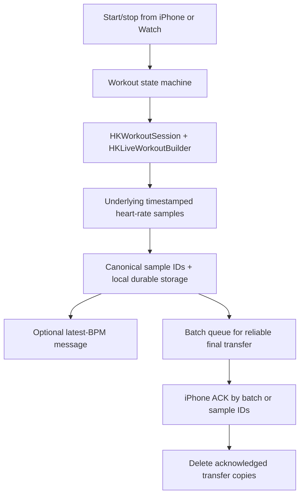

# Apple Watch App — Heart-Rate Acquisition & Synchronization Plan

**Platform:** watchOS on a physical, paired Apple Watch  
**Preferred production implementation:** SwiftUI + Swift / native HealthKit; linked to Expo iOS project through an Xcode watch target  
**Experimental alternative:** `@appsent-co/react-native-watchos` in the Expo project, with a custom native HealthKit module  
**Principal function:** Collect timestamped heart-rate observations reliably for each iPhone-owned trial

## 1. Design goal and stack decision

The Apple Watch application is a **measurement instrument**, not a full navigation application. It needs to:

- Start an outdoor walking workout at the request of the iPhone or through an explicit Watch confirmation.
- Receive HealthKit heart-rate samples while the workout is active.
- Show elapsed time, current/recent BPM, sample count and connectivity/sync condition.
- Cache every sample locally even if phone connectivity disappears.
- Stop and finalize its workout on request, or let the wearer stop it on the Watch.
- Reconcile the complete sample series with the iPhone trial, preventing data loss and duplicates.

### Two watch UI choices

**A. Recommended / safest: SwiftUI watch app.** Implement the full sensor and sync lifecycle in Swift, using `HKWorkoutSession`, `HKLiveWorkoutBuilder`, and `WCSession`. This path best isolates important measurement logic from experimental cross-platform runtimes. Expo still powers the iPhone app and can coexist with a native Watch target; custom native project wiring must survive prebuild or be intentionally maintained in Xcode.

**B. React Native watchOS proof-of-concept.** The pre-release `@appsent-co/react-native-watchos` project can embed a Watch React runtime in an Expo project, using `@bacons/apple-targets` for the target and `index.watchos.tsx` as the Watch entry. Its documented WatchConnectivity bridge supports both iPhone and Watch messaging. However, the package is pre-release, some APIs can change, and ordinary iOS React Native / Expo packages **cannot be assumed to run on watchOS**. A custom **native Swift HealthKit TurboModule** is still necessary for secure acquisition and background workout session lifecycle. Validate on actual hardware before choosing this path.

**Decision gate:** watch HR sampling, 30–60 minute real-device workout, app suspension/background handling, start/stop, crash recovery, final transfer while disconnected and iOS companion install must all pass. If not, use SwiftUI without changing the study data format.

## 2. Watch app UI

| View | Elements | Notes |
|---|---|---|
| Waiting | “Waiting for iPhone”, paired state, permission state, start manually if permitted | Avoid implying a connected Watch is already collecting HR. |
| Active | BPM or `--`, last sample age, elapsed time, sample count, pause/finish buttons, iPhone connection indicator | Large, high-contrast typography; minimize display power use. |
| Paused | “Paused”, elapsed time, resume/finish | Explicit pause event; don't silently call missing HR samples zero. |
| Finishing | “Saving samples…”, queued count, transfer status | Workout completion and data delivery are separate operations. |
| Saved / pending | Trial name or abbreviated ID, `Transferred` / `Waiting to sync` | Offline queue persists after application exit. |
| Error / permission | No HealthKit access, workout already running, Watch locked, low battery, no companion | Specific remedies and persistent error event. |

A start command may be sent by the phone, but **never assume silent remote start is guaranteed** by watchOS lifecycle rules. The user may need to foreground the Watch app / confirm; show an explicit readiness step and store the actual Watch workout start timestamp. Live measurements begin only after HealthKit confirms a running session.

## 3. HealthKit measurement subsystem

### Required platform setup

- Create an appropriately associated watchOS target; enable HealthKit capability and required privacy strings on the Watch target. Request authorization to read heart-rate quantity samples; add workout write authorization **only if** creating/saving a workout record in HealthKit.
- Verify the target's entitlements and Info.plist entries under the selected Xcode/SDK configuration; do not copy undocumented keys blindly.
- Use `HKHealthStore`, a configuration with `activityType = .walking` and `locationType = .outdoor`, then create an `HKWorkoutSession` and associated `HKLiveWorkoutBuilder`. Attach delegates before starting collection.
- Read/sample observations through the builder's data callbacks or appropriately scoped anchored queries for the active workout, capturing the **underlying timestamped `HKQuantitySample` observations** where available. A builder's current BPM statistic is **not** a substitute for the raw timestamped sample series needed for analysis.
- Treat heart rate as **irregularly sampled**. Apple Watch chooses its own sensor measurement cadence; 1 Hz data is **not guaranteed**. Save sample start/end timestamps and units (count/min), not assumed one-second synthetic values.
- If a new workout begins in another app, the workout can be interrupted. End/flag the trial accordingly; never hide interruption.
- HealthKit permission can be denied or changed. Detect lack of usable samples and inform the participant; do not fabricate missing BPM values.

### Acquisition architecture



Do not discard Watch-local records merely because the OS reports that a message was sent. Delete **outbox copies** only after an application-level acknowledgement confirming that the iPhone committed them. Prefer storing the batch itself until ack; even if the app crashes between sending and acking, resent data is deduplicated on the phone.

### Workout state machine

```text
idle -> requesting_permission -> ready -> starting -> recording
                                                 |          |
                                             failed      pausing
                                                          |
                                                       paused
                                                          |
                                                     resuming
                                                          |
                                                       recording
recording/paused -> stopping -> workout_finished -> sync_pending -> synced
```

- Record `watch_session_id` and `trial_id` at `starting`.
- Make start requests idempotent; starting an already-active trial should return its status instead of opening another workout.
- If a stop request arrives before Watch start acknowledgement, persist a `stop_requested` event and reconcile when the Watch responds.
- Implement explicit expiration/interruption events and recovery after process relaunch.
- Default to one active study workout at a time. Detect an already-running unrelated workout and show failure rather than preempting it.

## 4. iPhone ↔ Watch synchronization

Use **Apple WatchConnectivity (`WCSession`)**, not a fabricated WebSocket channel between devices. Both sides activate sessions and react to reachability changes.

| Direction | Message | Delivery strategy | Required acknowledgement |
|---|---|---|---|
| Phone → Watch | `HELLO`, `PREPARE`, `START`, `PAUSE`, `RESUME`, `STOP`, `SYNC_REQUEST` | Immediate `sendMessage` where Watch reachable; persist desired command / pending state for later reconciliation | Yes, on state-changing commands |
| Watch → Phone | `WATCH_READY`, `STARTED`, `PAUSED`, `RESUMED`, `STOPPED`, `ERROR`, `STATUS` | Immediate when reachable, queue critical state events for later | State changes should be persisted on phone |
| Watch → Phone | `HR_LIVE` | Best-effort real-time display only | No; not used as sole source of final measurements |
| Watch → Phone | `HR_BATCH` | `transferUserInfo` for compact data; `transferFile` for larger files, plus app-level retry/dedup | Yes, `BATCH_ACK` after SQLite transaction |
| Phone → Watch | `BATCH_ACK` | Immediate or durable sync-status reconciliation | Carries `(trial_id, batch_id, checksum)` |

`updateApplicationContext` holds **latest state only** and must not carry measurement history; later updates overwrite prior context. `sendMessage` is for reachable, low-latency communication but is not a durable history transport. Apple documents queued `transferUserInfo` and `transferFile` for background transfers. Always test delayed transfer with actual paired devices.

### Start handshake

1. iPhone creates a unique `trial_id`, initializes a trial record, and submits `PREPARE {trial_id, route_id, protocol_version}`.
2. Watch reports authorized, installed, workout-available, session-active, queued sample count, and latest state.
3. User initiates `START`; Watch establishes workout and returns `STARTED` with `watch_session_id`, `watch_started_at_utc_ms` and a monotonic timestamp if available.
4. iPhone begins / confirms GPS sampling and records both iPhone and Watch start events. The exact starts may differ; retain both for analysis.
5. During recording the Watch persists HR first, then optionally publishes recent BPM live.
6. `STOP` prompts final workout completion, flush to durable outbox and final `STOPPED` with counts and hashes; iPhone marks `sync_pending` until all batches are validated.

### Recovery and clock alignment

- Use **UTC millisecond epoch timestamps** and preserve *sample-native HealthKit timestamps*. For durations use platform elapsed/monotonic timing when accessible and record wall-clock anchors; a phone/app clock adjustment must not create negative duration.
- On session start and periodically, exchange a small `PING/PONG` timing probe and estimate device clock offset and uncertainty from multiple round trips. Store the estimates as diagnostic metadata; **do not** change the original `HKQuantitySample` timestamps. If clock offsets are unstable, mark lower confidence in HR-to-location matches.
- `HR_BATCH` carries `trial_id`, `watch_session_id`, `seq_start`, `seq_end`, `batch_id`, `protocol_version`, sample IDs/timestamps/BPM, and checksum. Deduplicate by canonical HealthKit UUID or `(watch_session_id, sequence)`.
- Do not assume message arrival order equals measurement time. Sort by sample timestamps, with sample ID/sequence for stable ties.
- At reconnect, exchange local and remote cursor/highest-acked batch; resend unacknowledged batches. The phone should accept previously received batches idempotently and return ACK again.
- Prevent cross-trial contamination by verifying `trial_id` on every command/event/batch.

## 5. Local Watch storage and battery management

Store a small durable append-only JSONL/file or native lightweight database in Watch app storage. Each record includes `trial_id`, `watch_session_id`, `sample_id`, HR interval timestamps, BPM, sequence and source. Track pending outbox batches and last phone ACK.

- Flush at practical small intervals and every state transition. Test abrupt process termination.
- Avoid high-frequency display redraws just because HR samples arrive; refresh once per sample or less.
- Use HealthKit's workout session to support activity acquisition; do not rely on keeping a JS timer awake in the background.
- Make lower-battery / thermal warnings visible; do not promise continuous sampling under all watch conditions.
- Avoid storing exact participant names or uploading samples to third parties.
- On Watch loss/reinstall, the iPhone retains already synced records; missing data must remain visible rather than estimated.

## 6. Choosing React Native on Apple Watch: technical spike

**Pre-release toolchain:** `@appsent-co/react-native-watchos` + `@bacons/apple-targets`. Official package docs currently describe:

```bash
npx expo install @appsent-co/react-native-watchos @bacons/apple-targets
npx react-native-watchos init
# Also configure metro.config.js per the package's installation guide.
npx expo prebuild -p ios --clean
npx expo run:ios
```

The setup generates a watch target and an `index.watchos.tsx` entry; the Watch UI uses the library's SwiftUI-backed React primitives rather than ordinary React Native iOS view components. **Do not treat this as a verified production setup for Expo SDK 58 until you build on the team’s exact paired devices.** The heart-rate acquisition still belongs to a native module:

```text
watchos/HealthRecorder.swift
  authorizeHeartRate()
  startWorkout(trialId)
  stopWorkout(trialId)
  listPendingHeartRateSamples(trialId, cursor)
  acknowledgeBatch(trialId, batchId)
  onWorkoutStateChanged / onHeartRateObserved events

watchos/NativeHealthRecorder.ts  # JS TurboModule spec
index.watchos.tsx                # React UI only, no JS-driven sensor polling
```

**Go/no-go criteria:**

- [ ] clean reproducible prebuild from committed config produces the watchOS target;
- [ ] iOS companion and Watch install/launch on physical paired devices;
- [ ] native HealthKit TurboModule can authorize, start, capture timestamped samples and stop;
- [ ] 30–60 minute recording survives screen-off/normal suspension;
- [ ] disconnect/reconnect yields complete, duplicate-free final sample series;
- [ ] Watch UI can display recording/error states and recover after relaunch;
- [ ] a release-mode build embeds the Watch JS bundle and does not require Metro.

If any critical criterion is not reliably met within the agreed discovery time, switch **only the Watch UI/runtime** to SwiftUI. Keep the iPhone Expo app, native recorder, WatchConnectivity contract, data schema and tests.

## 7. Test cases and measurable acceptance standards

| Case | Expected result |
|---|---|
| Permission denied / limited access | Explain blocked data, leave HR trial invalid, no fake samples |
| iPhone not reachable for 10–30 minutes | Watch still records and persists samples, then delivers after reconnect |
| Duplicate batch retry | No duplicated HR rows on iPhone; ACK is safe to repeat |
| Start sent twice | Exactly one workout session for the trial |
| Watch stops without phone | iPhone eventually receives stopped status and final HR batch; trial flagged if GPS continued |
| iPhone crashes before stop | Watch preserves active state and samples; resync/recover or user ends from Watch |
| Other workout starts | Appropriate interruption / `incomplete` status; no silent continuation |
| End workout, immediately close both apps | Outbox persists; data transfers when next available |
| Timestamp disagreement / HR missing segments | Uncertainty displayed and missing samples excluded from plot interpolation |
| Final counts | Watch total unique HR IDs = iPhone unique imported HR IDs after completed sync |

## 8. Deliverables

1. Signed watchOS target with HealthKit entitlements and correct pairing to iPhone bundle ID.
2. Workout recorder service with timestamped HR samples, local persistence, state events and unit tests.
3. Watch UI showing BPM/sample age, session progress, sync and error status.
4. Versioned WatchConnectivity commands, durable batches, duplicate-safe ACK and reconnection tests.
5. Real-device test report (models, watchOS/iOS versions, battery drain, sampling gaps, Bluetooth disconnections).

## References

- Apple HealthKit workout sessions: https://developer.apple.com/documentation/healthkit/running-workout-sessions
- Build Apple Watch workout app: https://developer.apple.com/documentation/healthkit/build-a-workout-app-for-apple-watch
- `HKLiveWorkoutBuilder`: https://developer.apple.com/documentation/healthkit/hkliveworkoutbuilder
- `WCSession`: https://developer.apple.com/documentation/watchconnectivity/wcsession
- Queued Watch transfer: https://developer.apple.com/documentation/watchconnectivity/transferring-data-with-watch-connectivity
- React Native watchOS introduction (pre-release): https://appsent-co.github.io/react-native-watchos/
- React Native watchOS Expo installation: https://appsent-co.github.io/react-native-watchos/getting-started/installation
- React Native watchOS TurboModules: https://appsent-co.github.io/react-native-watchos/native/turbo-modules
